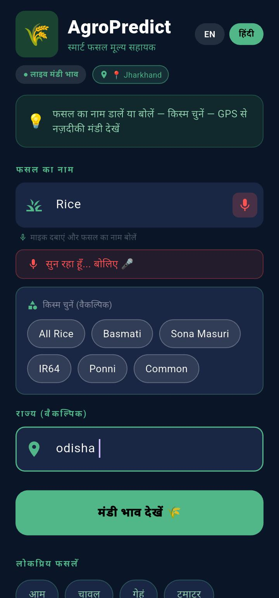
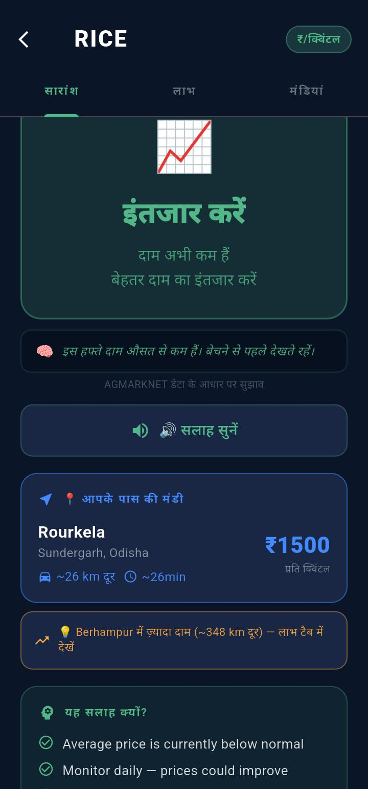
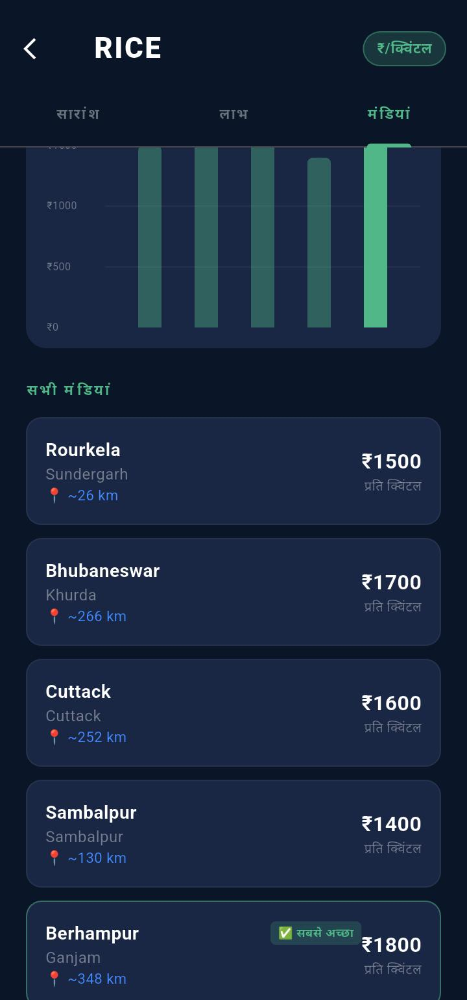
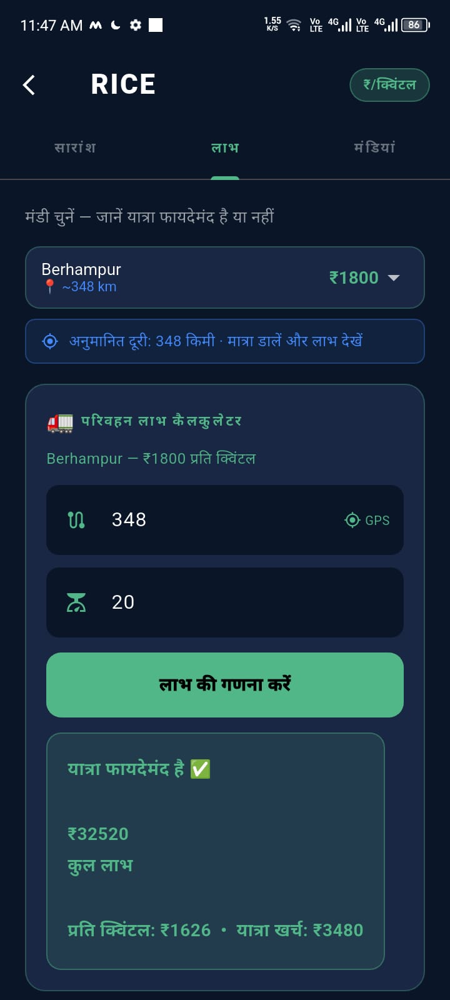

# Kshetraajeev (क्षेत्राजीव)


*Formerly AgroPredict. Smart Market Decisions for Farmers.*

A crop-price app for farmers in Jharkhand and Odisha. It compares mandi prices, subtracts the cost of travel, and tells the farmer where selling makes the most money. A farmer can type, or just speak in Hindi or English and hear the answer.

```
Farmer (Hindi):   "मेरे पास बीस क्विंटल धान है"
App understood:   Crop: Rice, Quantity: 20 quintal       (farmer confirms)
App answers:      Berhampur is the best market. Rs. 1800 per quintal.
                  About Rs. 31,853 for 20 quintal after travel cost.
                  (spoken aloud in Hindi; sample prices)
```

[Farmer documentary] (https://youtu.be/2PWweDEcCpc?si=dyoQ_XNtZMZJa5mE) · [Portfolio](https://priya-codesdaily.github.io) · [LinkedIn](https://linkedin.com/in/a-priya-dev) · [Field notes](FIELD_RESEARCH.md)

The documentary shows the app under its earlier name, AgroPredict.

## Screenshots

| Home | Speak and confirm | Best market answer |
|---|---|---|
|  |  |  |

| Advice | Markets | Profit calculator | Shared transport |
|---|---|---|---|
|  |  |  |  |

## Where this came from

My family grows crops every season, and every season we face the same problem: where to sell, and where to get the best price. Many times we lost money because we sold without knowing. I thought, if my family faces this, maybe other farmers face it too.

My father grows the crops and my mother handles the selling. She was the first person to test the app, and she used it without any guidance.

## How I built it

1. **A dummy app.** A simple 3-screen prototype to test the idea: enter a crop, see prices, get advice.
2. **Farm visits (May to July 2026).** I visited farms in Jharkhand and Odisha, asked farmers what they grow and what problems they face, and watched them use the app.
3. **Built from their feedback.** What I heard changed what I built. When my mother asked "which rice?", I added crop varieties within 24 hours.
4. **A new name.** AgroPredict became Kshetraajeev. The name describes the land and the person who works it, the farmer and cultivator. I wanted it to sound like the farmer, not like a technology product.
5. **Voice, November 2026.** A farmer told me reading is difficult. I had a Hindi interface, and I added Gnani's speech models so farmers can speak and listen.

## The problem

Farmers do not lack effort. They lack information: where to sell, to whom, whether the trip is worth the cost, and whether the price is fair. So many sell to the nearest mandi, or to whoever arrives first.

A supplier goes wherever the profit is, because he already knows the buyers and the margins. A farmer fears the trip: he does not know whether the price will be better, whether transport will eat the profit, or who will buy at the other end.

Sometimes the farther mandi still wins. In my research, mangoes were selling locally at Rs. 1,500 per quintal and fetching Rs. 1,800 at Berhampur, 347 km away. After estimated transport the trip was still about Rs. 200 per quintal better.

## Field research and farmer sessions

I spoke with **25 farmers and 2 market agents (27 people)** between May and July 2026. About 60% were in Jharkhand and 40% in Odisha. The conversations were informal: talking on the farm, watching farmers use the app, and noting what confused them or what they asked for. It was not a formal survey. **13 farmers appear in the documentary**, the ones who were comfortable on camera.

### What farmers said, and what I built

| What I heard | What it meant | What I built |
|---|---|---|
| "Kaunsi chawal?" (Which rice?) | A crop name alone is not enough | Variety selector, shipped within 24 hours |
| "Padhne mein dikkat hota hai" (Reading is difficult for me) | Reading is a barrier | Voice output, then Gnani voice in and out |
| "Profit nahi hota, mehnat ka faal nahi milta" | Hard work does not turn into earnings | Transport profit calculator |
| "Kitna kg mein?" | Per kg is more natural than per quintal | Rs/kg and Rs/quintal toggle |
| Farmers call friends to compare prices | Comparing is manual and slow | All-mandi comparison |
| Neighbours informally split transport cost | Sharing could make a far mandi worth it | Shared transport calculator |

### What I saw in the sessions

- My mother used the app on her own, with no help. Her question was about varieties, not about the app.
- A government block office worker in our district reached out on their own to test it. Their feedback shaped the second-version roadmap.
- Farmers wanted to see prices for their own crop varieties. Many were more comfortable with listening than reading.
- Not every farmer is comfortable with mobile apps, and the farmers most active on phones are often the smaller ones who need the most help.
- Two problems came up that I have not solved: when many farmers harvest together, prices fall and perishables like mango and tomato must be sold fast, and in the rainy season transport is hard and spoilage speeds up.

[Add 2 or 3 specific session stories here, for example "A farmer in Jharkhand said...". Use only things you are sure about, with no names.]

> "Padhne mein dikkat hota hai." (Reading is difficult for me.)
> A farmer, during field research

## What the app does

| Feature | What it means for the farmer |
|---|---|
| Speak | Say the crop and quantity in Hindi or English. The app confirms what it heard, finds the best market and speaks the answer. |
| Crop and variety search | Type or speak a crop; pick Basmati, Common, Alphonso and so on, because farmers think in varieties |
| GPS nearest mandi | Estimated distance and travel time to nearby mandis |
| Transport profit calculator | "Is the trip worth it?" Net money after estimated transport, compared with selling locally |
| All-mandi comparison | Every mandi side by side, with a bar chart and the best one highlighted |
| SELL / WAIT / MONITOR | Plain advice with reasons, read aloud on request |
| Shared transport calculator | Split a vehicle with neighbouring farmers and see what each one saves |
| Hindi and English | Full Hindi interface, and a Rs/kg toggle |
| Price date | Every result shows the actual date of the price |

## How the whole app works

```
                         Farmer
          types or speaks (Hindi or English)
                           |
                  Flutter app (Dart)
 +----------------------------------------------------------+
 | Home screen              Speak screen                     |
 |  crop, variety, state,    record -> confirm -> answer     |
 |  GPS, mic                        |                        |
 |        |                         v                        |
 |        v                  VoiceParser (rules)             |
 | Result screen: Overview | Profit | Markets                |
 |        |                                                  |
 | DecisionEngine: advice, distance, net return              |
 | MandiLocations: 55 hand-built mandi coordinates           |
 +-------------|--------------------------|-----------------+
               |                          |
         MandiService               VoiceService
               |                          |
   data.gov.in (AGMARKNET)          FastAPI backend
   or labelled sample data      (holds the Gnani key)
                                  /stt -> Gnani Prisma
                                  /tts -> Gnani Timbre
```

### Project layout

```
agropredict/
  backend/                 FastAPI: /health, /stt, /tts
  lib/
    main.dart
    screens/               home, voice, price_result, shared_transport
    services/              mandi_service (prices), voice_service (backend client)
    logic/                 decision_engine (advice, distance, profit), voice_parser
    models/                crop_model (CropPrice), crop_varieties
    data/                  mandi_locations (55 coordinates)
    theme/                 app_colors
  test/                    voice_parser_test (17 tests)
  .github/workflows/       runs the tests on every push
  screenshots/
  FIELD_RESEARCH.md
```

### The decision logic (plain Dart, no ML)

- **Net return** = modal price x quintals - distance in km x Rs. 12.
- **Profit tab:** net in hand = price x quantity - transport. The trip is "worth it" when that beats selling at the average price locally.
- **Distance** is a straight line from GPS to a mandi's coordinates. Travel time is an estimate.
- **Advice** compares the best mandi with the average of all mandis. The thresholds are rules I set by hand: more than 20% above average means SELL, an average below Rs. 1,500 means WAIT, a gain of 10 to 20% means WAIT, and everything else means MONITOR. They are simple heuristics and have not been validated.
- The same input always gives the same answer. AI is used only for speech.

## Voice with Gnani

Gnani handles the voice. It does not decide anything about money.

1. The farmer taps the mic and the app records a short clip (16 kHz mono WAV).
2. The app sends the clip to my backend (`POST /stt`), which forwards it to **Gnani Prisma** with the Gnani key and gets back the text, language and processing time.
3. `VoiceParser` finds the crop, quantity and unit, and the app shows "I understood: Rice, 20 quintal".
4. The farmer taps Yes, or tries again if it was misheard.
5. The decision logic picks the best market.
6. The app writes a short sentence from the numbers, in Hindi or English.
7. The app sends the sentence to the backend (`POST /tts`). **Gnani Timbre** returns audio, the backend repairs the WAV header, and the app plays it.

| Gnani model | Endpoint | Used for |
|---|---|---|
| Prisma (speech to text), `prisma-v3.0` | `POST /stt/v3` | Turns the sentence into text. The language is auto-detected. |
| Timbre (text to speech), `timbre-v2.5` | `POST /api/v1/tts/inference` | Speaks the recommendation. |

The backend calls these REST endpoints directly with `httpx`, and the key never goes into the app. Prisma's REST endpoint takes clips up to 30 seconds.

### What changed after adding Gnani

| | Before | After |
|---|---|---|
| Voice input | The phone's built-in engine, one crop word into a text box | A whole sentence in Hindi, English or mixed; crop and quantity picked out |
| Voice output | The phone's voice reading generic advice | Timbre speaks an answer built from the farmer's own quantity |
| Steps | Type the crop, pick a variety, find the Profit tab, enter distance and quantity | Say one sentence, tap Yes |
| Who it helps | Farmers who can read a Hindi screen | Also farmers who find reading difficult |
| Speed | n/a | About 0.3 s of processing for a short Hindi clip in my test |

## Examples

| You say or type | The app does |
|---|---|
| "मेरे पास बीस क्विंटल धान है" | Rice, 20 quintal. After you confirm: best market with earnings after travel cost, spoken in Hindi. |
| "I have twenty kg rice" | Rice, 20 kg. English answer, spoken in English. |
| "In which mandi is tomato higher in price?" | Tomato, no quantity. Shows the best price without an earnings figure. |
| "Mango", variety "Alphonso", typed | Prices for that variety, SELL/WAIT/MONITOR advice, nearest mandi and the profit tab. |
| A sentence with no crop in it | Says it could not find a crop and suggests what to say. |

## Testing

- 31 unit tests cover the voice parser: Hindi and English sentences, digits and number words, two-word numbers like "twenty five", kg and quintal, English speech written in Devanagari letters, spelling variants from the speech model, and missing information.
- GitHub Actions runs `flutter test` on every push.
- Not tested yet: the screens, the backend, and the decision logic.

## Measured accuracy

I recorded 40 sentences (20 Hindi, 10 English, 10 Hinglish), sent each one through the real backend to Gnani Prisma, and scored whether the app found the right crop, quantity and unit. The sentences are in `eval/expected.csv` and the transcripts Prisma returned are in `eval/transcripts.json`. The recordings themselves are not published.

| Group | First run | After fixing the parser |
|---|---|---|
| Hindi | 10 of 20 | 17 of 20 |
| English | 5 of 10 | 9 of 10 |
| Hinglish | 7 of 10 | 8 of 10 |
| **All** | **22 of 40 (55%)** | **34 of 40 (85%)** |

Median time from sending a clip to getting the text back: 1.8 s (95th percentile 3.9 s).

**What went wrong in the first run.** Of 18 failures, 12 were my parser's fault:
- The speech model spells the same Hindi word in several ways (for example `गेहूँ` and `प्याज़`, with a chandrabindu or a dotted letter), and my word list had only one spelling.
- My number list was missing words like दो, आठ, बारह and अस्सी.
- "twenty five" was read as 20.

I fixed these and added tests for each. The 6 failures that remain are speech recognition mistakes the parser cannot repair: "दस" heard as "कितना", "करेला" (bitter gourd) heard as "केला" (banana), "fifteen" heard as "fifty", "wheat" heard as "बी", a number dropped from a clip, and one clip returned in Punjabi script. This is why the app shows what it understood and asks the farmer to confirm before it answers.

**Unseen sentences.** I tuned the parser on those 40 sentences, so I then recorded 10 new ones and scored them once, without changing the parser.

| Set | Sentences | Correct |
|---|---|---|
| Tuned set (the parser was fixed using these) | 40 | 34 (85%) |
| Unseen set (scored once, parser not changed) | 10 | 8 (80%) |

The two failures on the unseen set:
- "ग्यारह" (eleven) was heard as "क्या एक", so the quantity came out as 1. This is a speech recognition error, which the confirm card exists to catch.
- "paddy" was written as "पेड़ी", a spelling my crop list did not have. This is a parser gap. I left it unfixed so the number stays honest, and a fix would need a new unseen set.

**Caveat.** Ten sentences is a very small sample: 8 of 10 is consistent with a true accuracy anywhere between roughly 50% and 94%. The clips were recorded by me and parents, so this is not a varied test of accents or noisy fields. Read it as "around 80 to 85% on these sentences", not as an exact number.


## What failed, and what I learned

| What went wrong | What I did | What I learned |
|---|---|---|
| My live-price API key was rejected (HTTP 403), and the app silently showed built-in sample prices as if they were live. | Added a clear **SAMPLE DATA** label. Live prices are still not working. | Never hide a failure from the user. A farmer must know when a number is not real. |
| A bug showed "0 mandis" on every search. Two stray `return []` statements had emptied the list. | Found it by tracing where the list became empty. | Look at where the data actually changes, not where the symptom appears. |
| Auto language detection read a single spoken word ("tamatar") as another language's script. | Voice works best with full sentences, and the parser understands English words written in Devanagari letters. | Real speech is messier than test data. |
| Timbre audio would not play in the browser because the WAV length was left unset. | The backend repairs the header. | Read the actual bytes of a failing response. |
| An early version had an API key hardcoded in the app. | Moved keys to environment variables and rotated them. | Secrets belong on the server. |
| The mandi distance for Rourkela showed about 23 km, but the road is about 43 km. | Documented it as an estimate. | Straight-line distance is a rough guide only. |
| I could not get wireless debugging to work, so the voice flow has only been tested in Chrome. | Android testing with the backend is still to do. | Test where the user is, not only where it is easy. |
| My first accuracy test scored 55%. | Traced each failure: 12 were parser mistakes (spellings, number words), fixed them with tests; 6 were speech recognition mistakes. Now 85%. | Measure first, then fix, and separate your bugs from the model's. |

## Known limits

- Prices are **sample data** unless a live data.gov.in key is configured, and the app says so.
- Distance is a straight line, and transport is a flat Rs. 12 per km. Real roads are longer.
- Mandi distances cover only my 55 hand-built coordinates, even though AGMARKNET lists many more mandis.
- The advice rules are hand-set heuristics, not validated against real outcomes.
- Voice understanding is rule-based: 11 crops and a limited set of number words. English speech may come back in Devanagari letters.
- Odia is **not supported yet**. I have not been able to confirm Odia through the Gnani API. Timbre is marked beta.
- The research is informal conversations with 27 people. Not every farmer is comfortable with apps, and the effect on real earnings has not been measured.
- Audio is sent to Gnani for transcription. The backend does not store it.

## Run it

You need Flutter, Python 3.11+, Chrome, and a Gnani API key (free at app.gnani.ai).

```bash
git clone https://github.com/priya-codesdaily/agropredict && cd agropredict/backend
python -m venv venv
venv\Scripts\activate
pip install -r requirements.txt
copy .env.example .env        # then put your GNANI_API_KEY in .env
uvicorn main:app --reload --port 8000
```

In a second terminal, from the project root:

```bash
flutter pub get
flutter run -d chrome
flutter test
```

Open `http://127.0.0.1:8000/health`. You should see `"gnani_key_loaded": true`. In the app, tap SPEAK and say "मेरे पास बीस क्विंटल धान है". Without a data.gov.in key the app shows sample prices and labels them. On an Android phone, put your laptop's address in `lib/services/voice_service.dart`.

## Roadmap

- [x] Price date shown on every result
- [x] Variety selector (shipped within 24 hours of feedback)
- [x] Voice output in Hindi and English
- [x] Full Hindi interface and Rs/kg toggle
- [x] Shared transport calculator
- [x] Gnani voice input and spoken answers
- [x] Unit tests and CI
- [x] Accuracy test on 40 spoken sentences (85%)
- [ ] Live prices
- [ ] Backend hosted online, and an Android test of the voice flow
- [ ] Odia language
- [ ] Offline mode for low connectivity
- [ ] Price history, weather-aware advice, buyer and supplier contacts
- [ ] Closed test on Google Play with real farmers

## About

Made by Anshu Priya, a BCA student from a farming family on the Jharkhand-Odisha border. The price comparison, profit calculator, variety selector and Hindi interface were built as AgroPredict; the voice flow, backend, tests and new name came later.

AI use: Claude (Anthropic) helped with code, debugging and documentation. The field research, the documentary and the product decisions are my own.

[LinkedIn](https://linkedin.com/in/a-priya-dev) · [Portfolio](https://priya-codesdaily.github.io) · priyatech.logic@gmail.com

MIT License. See [LICENSE](LICENSE).